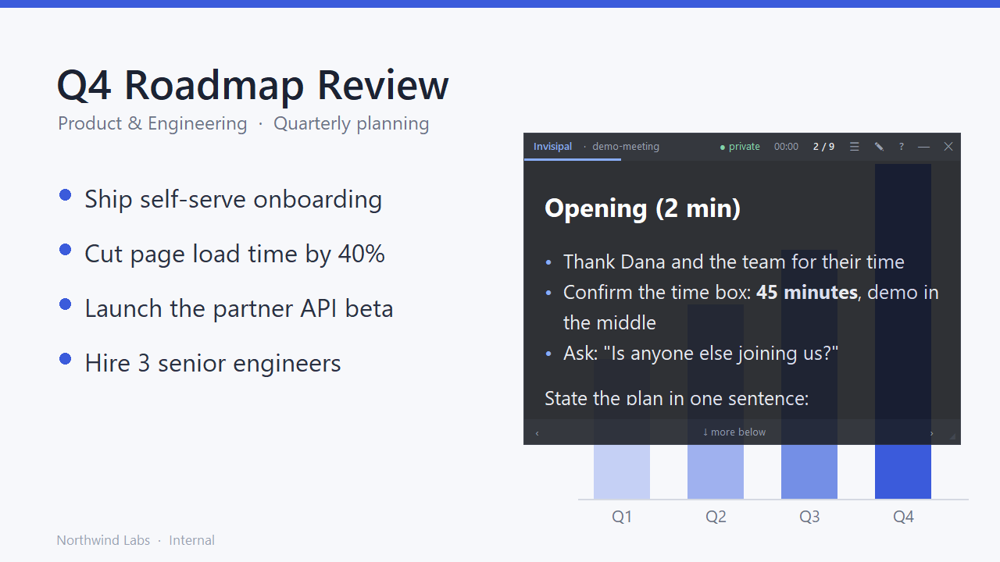
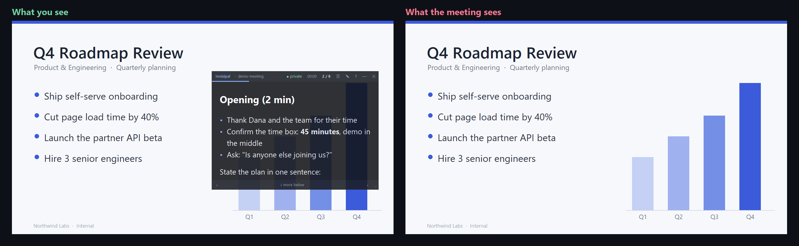

<div align="center">

# Invisipal

**A private teleprompter for meetings. You see your notes. The people you share your screen with don't.**

[](https://github.com/nicoopal/invisipal/actions/workflows/ci.yml)
[](LICENSE)


[Español](README.es.md) · [How it works](docs/how-it-works.md) · [FAQ](docs/faq.md) · [Changelog](CHANGELOG.md)



</div>

## Why

You are sharing your entire screen in Teams, Zoom or Google Meet and you want your talking points, an agenda, a pricing cheat sheet or a full script in front of you, without alt-tabbing, without a second device and without the audience seeing a sticky note floating over your slides.

Invisipal is a small always-on-top window that shows your notes **one card at a time**. It asks Windows to exclude itself from screen capture (`SetWindowDisplayAffinity` with `WDA_EXCLUDEFROMCAPTURE`), so when you share your **entire screen** the window is simply not part of the picture other people receive.

<div align="center">

<br><sub>Left: your monitor. Right: what the meeting receives.</sub>
</div>

Pure Python standard library (tkinter + ctypes). No dependencies, no installer, no network access, no telemetry.

## Features

- **Hidden from screen sharing, screenshots and recordings** made with the Windows capture APIs, in Teams, Zoom, Google Meet, OBS and anything else that captures your screen.
- **One card at a time** (`3 / 10`), with a progress bar and a preview of the next card's title.
- **Global hotkeys** that work while another app has focus, so your meeting window never loses it. All rebindable.
- **Teleprompter paging**: on a long card, "next" scrolls down a page first and only then advances.
- **Translucent, borderless, always on top**, with adjustable opacity and text size, and optional click-through so the mouse passes straight through it.
- **Hidden from the taskbar and Alt+Tab** by default, because the taskbar is part of what you share.
- **Everything happens inside the one protected window**: reader, editor, guide library and help. There are no popups, menus or dialogs, because those would be separate windows that *can* be captured.
- **Plain-text guides**: `.md` / `.txt` files in a folder. Edit them in VS Code or Notepad and Invisipal reloads them automatically.
- **Paste and go**: press `Ctrl+V` and the clipboard becomes a new guide.
- **Small Markdown subset** (headings, lists, checklists, quotes, code, bold, italic, `==highlight==`, strikethrough).
- **Meeting timer**, remembered position per guide, remembered window position and size.
- **Honest status badge**: `● private` when the window is hidden from capture, `● VISIBLE` when it is not.
- **Single instance**: launching it again just brings the running window back.

## Quick start

### Option A: download the release (no Python needed)

1. Download the zip from the [Releases page](https://github.com/nicoopal/invisipal/releases).
2. Extract it anywhere (your settings and guides are stored in `Documents\Invisipal`, not next to the `.exe`).
3. Run `Invisipal.exe`.

### Option B: run from source

Requires Windows 10 version 2004 or newer (or Windows 11) and Python 3.10+ with tkinter (included in the python.org installer).

```powershell
git clone https://github.com/nicoopal/invisipal.git
cd invisipal
pythonw invisipal.pyw        # no console window
# or:  python -m invisipal
```

You can also double-click `invisipal.pyw`.

The window opens in the top-right corner showing an example guide. Press `?` (with the window focused) to see every shortcut and the status of each hotkey, `Ctrl+Alt+H` to hide or show it, and `Ctrl+Alt+Q` to quit.

## Verify it's invisible

Do this once on your machine, and again before any meeting that matters. It takes two minutes.

**The real test, with your phone:**

1. Start a meeting in the app you will actually use (Teams, Zoom, Google Meet...).
2. Join the same meeting from your phone, as a second participant. Mute the phone's microphone and speaker to avoid feedback.
3. On the PC, **share your entire screen**, not a single window.
4. Start Invisipal (if it's not running) and make sure it is on screen, for example over the shared content.
5. Look at the phone. You should see your desktop and apps, and **no Invisipal window**. Move Invisipal around and change its size to be sure.

**The 10-second test:** press `Win+Shift+S` and take a rectangle snip over the Invisipal window. The saved image should show whatever is behind the window, not the window.

**Read the badge** in the window header:

| Badge | Meaning |
|---|---|
| `● private` (green) | Hidden from capture. This is what you want. |
| `● blacked out` (amber) | Old Windows 10 (before 2004): the window shows up to others as a black rectangle instead of disappearing. Update Windows. |
| `● VISIBLE` (amber) | Protection is deliberately off (`--no-protect` or `"capture_protection": false`). Others can see the window. |
| `● VISIBLE` (red) | Windows refused the request. Others can see the window. |

> Sharing a *specific window* (instead of your entire screen) is fine too, but then Invisipal is not part of what you share in the first place.

## Writing guides

A guide is a plain `.md`, `.markdown` or `.txt` file in the `guides/` folder, one file per meeting. A guide is split into **cards**, and each card is shown on its own.

### How cards are split

By default (`"split_mode": "auto"`) Invisipal picks the first rule that applies to the file:

1. **Separator**: if any line contains only `---` (three or more dashes), those lines separate the cards.
2. **Heading**: otherwise, every `#` or `##` heading starts a new card.
3. **Paragraph**: otherwise, every blank line starts a new card.

```markdown
# Opening                      <- card 1
Thanks everyone for joining.
State the goal: leave with a decision.

---                            <- separator

## Agenda                      <- card 2
1. Status
2. Decision
3. Next steps
```

You can also force a mode with `"split_mode"`: `separator`, `heading`, `paragraph`, `none` (the whole file is one long card, ideal for a script) or `auto`. In the editor, the **Split** button cycles through the modes.

Separators and headings inside fenced code blocks are ignored.

### Supported Markdown

Only a deliberately small subset is rendered, so cards stay readable at a glance. Anything else is shown as plain text.

| Syntax | Result |
|---|---|
| `# Title`, `## Title`, `### Title` | Headings (levels 4-6 look like level 3) |
| `- item`, `* item`, `+ item` | Bullet list; indent by 2 spaces to nest |
| `1. item`, `1) item` | Numbered list |
| `- [ ] task`, `- [x] done` | Checklist (done items are dimmed and struck through) |
| `> quote` | Quote |
| `` `code` `` | Inline code |
| Fenced block with three backticks or `~~~` | Code block |
| `**bold**` or `__bold__` | Bold |
| `*italic*` | Italic |
| `==highlight==` | Highlight (amber), for what you must not forget |
| `~~strike~~` | Strikethrough |
| `***` or `___` on its own line | Horizontal rule |

Not supported: tables, images, links (shown as literal text), HTML. Emoji may not render well in Tk, so avoid them.

A complete example lives in [`guides/demo-meeting.md`](guides/demo-meeting.md) (English) and [`guides/guia.txt`](guides/guia.txt) (Spanish).

### Ways to create and edit guides

- **Paste workflow**: copy any text, focus Invisipal and press `Ctrl+V`. It becomes a new guide named `pasted-YYYY-MM-DD-HHMM.md` and opens immediately.
- **Library** (`L` or the `☰` button): lists the guides with their card counts. Click one to open it, `+ New` to create one, `Paste as new` to import the clipboard. Rename or delete guides in the folder itself (`Open folder`, which opens Windows Explorer; remember that Explorer is *not* hidden from capture).
- **Built-in editor** (`E` or the `✎` button): `Ctrl+S` saves, `Esc` cancels (press it twice to discard unsaved changes), `Ctrl+Enter` inserts a `---` card break. `Replace with clipboard` swaps the whole text and can be undone with `Ctrl+Z`.
- **Any external editor**: guides are checked once a second and reloaded when the file changes (`"auto_reload"`), so you can keep a guide open in VS Code and see edits live. The reload is skipped while Invisipal's own editor is open.

## Keyboard shortcuts

### Global hotkeys

They work from any app, without focus, and are registered with the system (`RegisterHotKey`).

| Hotkey | Config key | Action |
|---|---|---|
| `Ctrl+Alt+Right` | `next` | Next card (on a long card, scrolls down a page first) |
| `Ctrl+Alt+Left` | `prev` | Previous card (scrolls back up first on a long card) |
| `Ctrl+Alt+Home` / `End` | `first` / `last` | First / last card |
| `Ctrl+Alt+Up` / `Down` | `font_up` / `font_down` | Bigger / smaller text (hold to repeat) |
| `Ctrl+Alt+PageUp` / `PageDown` | `opacity_up` / `opacity_down` | More opaque / more transparent (hold to repeat) |
| `Ctrl+Alt+H` | `toggle` | Show / hide the window, without stealing focus from your meeting app |
| `Ctrl+Alt+T` | `click_through` | Click-through on / off. When on, the mouse passes through the window. The title shows "click-through". |
| `Ctrl+Alt+G` | `next_guide` | Switch to the next guide in the folder |
| `Ctrl+Alt+S` | `timer` | Start / pause the timer |
| `Ctrl+Alt+R` | `reload` | Reload the current guide from disk |
| `Ctrl+Alt+Q` | `quit` | Quit |

Hotkeys are rebindable in `config.json`; setting one to `""` disables it. See [Configuration](#configuration).

**Keyboard layouts with AltGr (Spanish / Latin American, German, ...).** Windows reports AltGr as `Ctrl+Alt`. A global `Ctrl+Alt+Q` would therefore swallow `AltGr+Q`, which types `@` on those layouts, and you could not type `@` in any app. Invisipal checks, for every `Ctrl+Alt+<key>` hotkey, whether that combination types a character on your active layout, and if it does it registers `Ctrl+Alt+Shift+<key>` instead (for example `Ctrl+Alt+Shift+Q` to quit). The help view (`?`) always shows the combination actually in effect. This behavior is controlled by `avoid_altgr_conflicts` (default `true`).

**Intel graphics drivers.** Some Intel drivers use `Ctrl+Alt+Arrow` to rotate the screen. If the help view shows `(in use by another app)` next to a hotkey, another program already owns it: turn the Intel hotkeys off in the Intel graphics control panel, or rebind the action.

### When the Invisipal window has focus

| Key | Action |
|---|---|
| `Right`, `Space`, `PageDown`, `Down` | Next card (pages through long cards first) |
| `Left`, `Backspace`, `PageUp`, `Up` | Previous card |
| `Home` / `End` | First / last card |
| `+` / `-` | Bigger / smaller text |
| `E` | Edit this guide (`Ctrl+S` saves, `Esc` cancels, `Ctrl+Enter` inserts a card break) |
| `L` | Guide library |
| `Ctrl+V` | Paste the clipboard as a new guide |
| `F5` | Reload from disk |
| `?` | Help: status, every shortcut, file locations |
| `Esc` | Leave editor / library / help |

### Mouse

| Action | Result |
|---|---|
| Drag the header | Move the window |
| Drag the `◢` grip (bottom-right) | Resize |
| `Ctrl` + wheel | Text size |
| `Alt` + wheel | Opacity |
| Wheel | Scroll a long card |
| Click the `‹` / `›` buttons | Previous / next card |
| Click the guide name or `☰` | Library |
| Click the timer | Start / pause |
| Double-click the timer | Reset |
| Click the badge | Open the help view |
| `—` / `✕` | Hide / quit |

## Where your data lives

Everything Invisipal writes lives in **`Documents\Invisipal`**:

```text
Documents\Invisipal\
├── config.json        window position and size, text size, opacity, hotkeys…
└── guides\            one .md / .txt file per meeting
```

- The folder is created on first run and seeded with the example guides. If you delete an example, it doesn't come back.
- The Documents folder is looked up through Windows (`SHGetKnownFolderPath`), so a Documents folder redirected to **OneDrive** works, and your guides sync and get backed up automatically.
- Updating or reinstalling Invisipal never touches this folder. If an older version kept `config.json` next to the app, it is copied over the first time.
- Press `?` in the app to see the exact paths, or click **Open folder** in the library (`L`).

**Portable mode.** To keep everything next to the app instead (for example on a USB stick), create an empty file named `portable` (no extension) next to `invisipal.pyw` / `Invisipal.exe`. `--data-dir PATH` overrides both.

## Configuration

Settings are stored in `config.json` in your data folder (see [Where your data lives](#where-your-data-lives)). It is created on first run and updated automatically when you move the window, change the text size, and so on. Edit it while Invisipal is closed (the app rewrites the file), and you only need to include the keys you want to change; everything else keeps its default.

| Key | Default | Meaning |
|---|---|---|
| `x`, `y` | `null` | Window position in pixels. `null` places it in the top-right corner. If the saved position is off-screen, the default is used. |
| `width`, `height` | `620`, `440` | Window size (minimum 280 x 160). |
| `opacity` | `0.85` | Window opacity, from `0.15` to `1.0`. |
| `always_on_top` | `true` | Keep the window above other windows. |
| `show_in_taskbar` | `false` | Show a taskbar button and list it in Alt+Tab. Off by default because the taskbar is part of what you share. Applied at startup. |
| `capture_protection` | `true` | Hide the window from screen capture. `false` makes it visible to others (same as `--no-protect`). |
| `font_family` | `"Segoe UI"` | Text font for cards. Falls back to Segoe UI if not installed. |
| `mono_family` | `"Cascadia Mono"` | Font for code and the editor. Falls back to Consolas, then Courier New. |
| `font_size` | `20` | Card text size, from 9 to 96. Changed with the size hotkeys. |
| `line_spacing` | `1.45` | Line spacing multiplier, from 1.0 to 3.0. |
| `guides_dir` | `"guides"` | Guides folder; relative paths are relative to the app folder, absolute paths work too. |
| `current_guide` | `"guia.txt"` | File name of the open guide. Updated as you switch guides. |
| `split_mode` | `"auto"` | `auto`, `separator`, `heading`, `paragraph` or `none`. See [How cards are split](#how-cards-are-split). |
| `auto_reload` | `true` | Reload the guide when it changes on disk. |
| `positions` | `{}` | Last card shown in each guide (managed automatically). |
| `avoid_altgr_conflicts` | `true` | Add `Shift` to `Ctrl+Alt` hotkeys that would otherwise block an AltGr character. |
| `hotkeys` | see above | Map of action to key combination. `""` disables an action. |
| `theme` | dark palette | Colors as `#rrggbb`: `background`, `surface`, `border`, `text`, `muted`, `heading`, `accent`, `code_bg`, `code_fg`, `quote`, `highlight_bg`, `highlight_fg`, `ok`, `warn`, `danger`. |

### Rebinding hotkeys

```json
{
  "opacity": 0.9,
  "font_size": 26,
  "hotkeys": {
    "next": "Ctrl+Alt+N",
    "prev": "Ctrl+Alt+P",
    "toggle": "Ctrl+Shift+F9",
    "click_through": "",
    "quit": "Ctrl+Alt+Shift+Q"
  }
}
```

A combination is one or more modifiers (`Ctrl`, `Alt`, `Shift`, `Win`) followed by exactly one key, joined with `+`. Keys: letters and digits, `Left` `Right` `Up` `Down`, `Home` `End`, `PageUp` `PageDown`, `Insert` `Delete`, `Space` `Enter` `Tab` `Esc` `Backspace`, `F1` to `F24`, `Num0` to `Num9`, `NumAdd` `NumSub` `NumMul` `NumDiv`, and `Plus` `Minus` `Comma` `Period` (`Ctrl+Alt+-` and `Ctrl+Alt++` also work; `-` is accepted as a separator too, as in `Ctrl-Alt-Right`). A mistake is reported as `config error: ...` in the help view and the rest of your bindings still work.

If `config.json` contains invalid JSON, Invisipal renames it to `config.broken.json` (so nothing is lost), starts with defaults and shows a red message.

## Command line

```
pythonw invisipal.pyw [options]      (or: python -m invisipal [options])
```

| Flag | Meaning |
|---|---|
| `--data-dir PATH` | Folder holding `config.json` and `guides/` (default: `Documents\Invisipal`). Useful for separate profiles or a custom synced folder. |
| `--guide NAME` | Open this guide (a file name inside the guides folder). |
| `--no-protect` | Do **not** hide the window from capture. For demos and for taking screenshots of Invisipal itself. The badge shows `● VISIBLE`. |
| `--version` | Print the version and exit. |
| `-h`, `--help` | Show help. |

Only one instance runs at a time. Starting Invisipal while it is already running (with any flags) just shows the running window and exits.

## How it works

The short version; the [full write-up](docs/how-it-works.md) has the details.

- **Capture exclusion.** After the window exists, Invisipal calls `SetWindowDisplayAffinity(hwnd, WDA_EXCLUDEFROMCAPTURE)`. The Desktop Window Manager then leaves the window out of any capture of the desktop. On Windows 10 builds before 2004 that flag does not exist, so it falls back to `WDA_MONITOR`, which paints the window black in captures (badge: `● blacked out`).
- **No flash.** The window is created at alpha 0 and only becomes visible once protection has been applied and verified.
- **Layered window.** Translucency uses the layered-window alpha of the Tk root window. Tk's `winfo_id()` is an inner child, so the real top-level handle is found with `GetAncestor(GA_ROOT)`.
- **Taskbar and Alt+Tab.** `WS_EX_TOOLWINDOW` removes the taskbar button and the Alt+Tab entry.
- **Click-through.** `WS_EX_TRANSPARENT` makes the mouse fall through to the window below.
- **Global hotkeys.** A dedicated thread registers them with `RegisterHotKey` and runs its own message loop on `MsgWaitForMultipleObjects`, so they work while the window is hidden or unfocused. Actions are passed to the UI thread through a queue.
- **Watchdog.** Once a second, the app re-reads the real window handle and re-applies the affinity and styles in case Tk recreated its wrapper window.
- **Single instance.** A named event; a second launch signals it and exits.

## Limitations and honest caveats

- It defeats **software** capture only. A phone camera pointed at your monitor, an HDMI/DisplayPort capture card, a screen recorder running on a different machine, or another person looking at your screen all see the window.
- **Windows 10 version 2004 (build 19041) or newer, or Windows 11.** Older builds can only black the window out. It does not run on macOS or Linux because it relies on Windows APIs.
- If you share a **specific window** instead of the entire screen, Invisipal is irrelevant: only that window is sent.
- The protection is implemented by Windows' Desktop Window Manager, so it applies to capture methods that go through it, which is how current meeting apps, OBS and the Snipping Tool capture the screen. It has been verified with a GDI screen grab on Windows 11 25H2; other capture paths are expected to behave the same, but test your own setup. Remote Desktop sessions, virtual machines, unusual GPU drivers or third-party "mirror driver" capture tools may behave differently.
- Meeting apps and Windows change over time. **Always run the phone test above before an important meeting**, and re-run it after updating Windows or the meeting app.
- If the window ever ends up off-screen or out of reach, see the [FAQ](docs/faq.md).

## Responsible use

Invisipal is meant for your own notes, scripts and talking points: presentations, sales calls, demos, interviews you are giving, accessibility needs, and practicing a speech. Please respect the rules of any setting where hidden aids are not allowed, such as exams, proctored assessments, and job interviews or tests that forbid notes. You are responsible for how you use it.

## Building from source and development

```powershell
python -m pip install pytest ruff
python -m pytest              # tests in tests/
ruff check .                  # lint
powershell -ExecutionPolicy Bypass -File scripts\build.ps1   # standalone .exe
```

CI (`.github/workflows/ci.yml`) runs lint and tests on every push and pull request; `release.yml` builds the zipped `.exe` that is attached to each GitHub release. Project settings are in `pyproject.toml`.

The pure-Python modules (`cards`, `markdown`, `config`, `guides`, hotkey parsing) are testable on any OS; everything that touches Win32 is isolated in `invisipal/win32.py`. See [CONTRIBUTING.md](CONTRIBUTING.md) for the code layout and guidelines.

## Roadmap

Ideas, not promises. Open an issue if one of these matters to you.

- System tray icon (without a taskbar button)
- Per-guide settings through front matter (opacity, size, split mode)
- Auto-scroll teleprompter mode with adjustable speed
- Speaker-notes sync from PowerPoint
- Per-card timers and a pace indicator
- Search and jump to a card
- Themes
- winget / Scoop packages

## Contributing

Bug reports, especially **capture issues** on your Windows build and meeting app, and pull requests are welcome. Read [CONTRIBUTING.md](CONTRIBUTING.md) first.

## License

[MIT](LICENSE) (c) 2026 Nico Palermo ([@nicoopal](https://github.com/nicoopal)).
